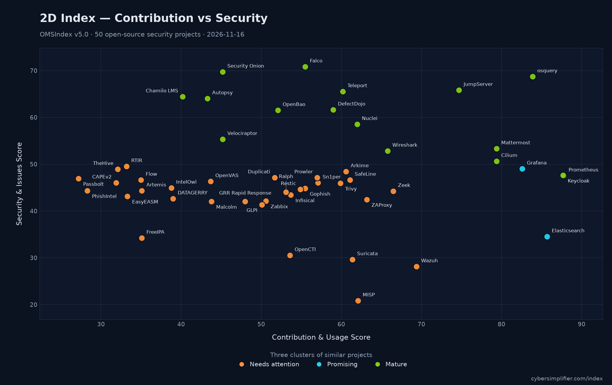

# OMSIndex

🛡️ **Open-source Maturity and Security Index** — a transparent, data-driven index of how mature and how secure open-source cybersecurity projects are.

This repository contains the reference implementation of **OMSIndex v5**, the same calculation that powers the live ranking at **[cybersimplifier.com/index](https://cybersimplifier.com/index)**. Given the same raw data it reproduces the published scores, ranks and clusters exactly (this is covered by the tests).



*2D Index — Contribution vs Security, snapshot of 2026‑11‑16. The interactive, daily refreshed version is on the [website](https://cybersimplifier.com/index).*

## Purpose

OMSIndex helps developers, organizations and security teams make informed decisions when adopting or contributing to open-source security tools. Every number in the index comes from public data and a published formula, so anyone can verify or challenge a result.

## How it works

```
GitHub REST + GraphQL API ─┐
                           ├─► raw metrics ─► component scores (0–1) ─► weighted index (0–100)
Shodan CVEDB ──────────────┘                                          ├─► 2D index (two dimensions)
                                                                      └─► 3 clusters of similar projects
```

### 1. Data collection

| Source | Data |
| --- | --- |
| [GitHub API](https://docs.github.com/rest) | stars, forks, subscribers (watchers), open issues, contributors and their contributions, releases, issues opened and closed in the last 30 days |
| [Shodan CVEDB](https://cvedb.shodan.io) | CVEs per product with CVSS score, EPSS probability and EPSS ranking, in three windows: last year, the year before, and full history |

The tracked projects (currently 50) are listed in [`projects.py`](projects.py).

### 2. Component scores

Each component is scored from 0 (worst) to 1 (best).

| Component | Weight | What scores well |
| --- | ---: | --- |
| `stars` | 4 | More stars than the other indexed projects (percentile) |
| `forks` | 7 | More forks than the other indexed projects (percentile) |
| `subscribers` | 10 | More watchers than the other indexed projects (percentile) |
| `contributorBalance` | 7 | The 10 most active contributors author close to 60% of the work — neither a one-person project nor one without a core team |
| `contributorDepth` | 7 | Few contributors with only a single contribution |
| `releaseCadence` | 0 ¹ | Close to one release every 30 days, both historically and in the last 60 days |
| `vulnerabilitiesRecent` | 4 | Few CVEs in the last year |
| `cvssRecent` | 4 | Low average CVSS in the last year |
| `issueResolution` | 7 | More issues closed than opened in the last 30 days |
| `issueLoad` | 4 | Fewer open issues per contributor than the other projects (percentile) |
| `vulnerabilityTrend` | 4 | Fewer CVEs in the last year than in the year before |
| `cvssTrend` | 8 | Average CVSS falling year over year |
| `epssTrend` | 8 | Average EPSS (exploitation probability) falling year over year |
| `epssRisk` | 7 | Low EPSS ranking of the most recent CVEs |
| `severeVulnerabilities` | 7 | Few high-severity CVEs (CVSS ≥ 7) in the last year |
| `severeShare` | 7 | Small share of high-severity CVEs among recent ones |
| `severityBurden` | 2 | Low count × average CVSS, relative to the other projects (percentile) |
| `cvssImprovement` | 7 | Recent CVSS score better than the previous year's |

¹ Release cadence does not count toward the overall index, but it does count (weight 7) in the *Contribution & Usage* dimension.

Popularity weights follow `subscribers > forks > stars`: watching a repository is the strongest signal of real technical use, a star the weakest. Security-policy presence is collected as metadata but is not scored. Projects with no vulnerability data get neutral-to-low scores for the vulnerability components rather than the best ones — no data is not the same as no vulnerabilities.

### 3. The index

* **Index (0–100)** — weighted average of all components. Projects are ranked by it.
* **2D index** — the same components split into two independent dimensions:
  * **Contribution & Usage** (X axis): `stars`, `forks`, `subscribers`, `contributorBalance`, `contributorDepth`, `releaseCadence`
  * **Security & Issues** (Y axis): all vulnerability and issue components
* **Clusters** — complete-linkage hierarchical clustering on the standardized raw metrics plus the two dimensions (which are weighted ×3) groups the projects into three clusters, named by their average index: **Needs attention**, **Promising**, **Mature**.

The exact thresholds and formulas are in [`omsindex_math.py`](omsindex_math.py), which has no third-party dependencies.

## Usage

Requires Python 3.9+.

```bash
pip install -r requirements.txt
```

**Full run** — collects fresh data from the APIs (about 2 minutes):

```bash
export GITHUB_TOKEN=<your token>   # any token; public read access is enough
python security_index.py
```

Without `GITHUB_TOKEN` the script still runs, but GitHub allows only 60 requests per hour and the contributor, release and issue-flow metrics are skipped, so the result will not match the published index.

**Recompute from a published snapshot** — no token needed; takes the raw data published by the website and recalculates everything:

```bash
python security_index.py --snapshot https://www.cybersimplifier.com/index-data.json
```

Options: `--output-dir DIR` (default `output`), `--no-plot` (skip the chart; matplotlib not needed), `--plot-file PNG` (save an extra copy of the chart).

### Output

| File | Content |
| --- | --- |
| `output/index-data.json` | Full result: raw data, component scores, index, 2D index, rank and cluster for every project. Same format as the website's data file. Also used as a fallback for the next run if an API call fails. |
| `output/<date>_index.csv` | The ranking as a table |
| `output/<date>_index_2d.png` | The *2D Index — Contribution vs Security* chart |

### Use as a library

```python
from omsindex_math import compute_index_v5

ranked = compute_index_v5(projects)   # list of {"name", "github": {...}, "vulnerabilities": {...}}
for project in ranked[:5]:
    print(project["rank"], project["name"], project["indexValue"], project["clusterKey"])
```

## Repository layout

| File | Purpose |
| --- | --- |
| [`security_index.py`](security_index.py) | Command-line entry point: data collection and output |
| [`omsindex_math.py`](omsindex_math.py) | Index v5 scoring, ranking and clustering |
| [`plot_index.py`](plot_index.py) | 2D chart |
| [`projects.py`](projects.py) | Tracked projects |
| [`euvd_client.py`](euvd_client.py) | Standalone client for the ENISA EUVD vulnerability database (not used in the index calculation) |
| [`tests/`](tests) | Tests, including a check against a snapshot published by the website |

## Tests

```bash
python -m unittest discover -s tests
```

## Why a fresh run can differ slightly from the website

The website refreshes once a day, so stars, issues and CVEs move between its run and yours. In addition, when the CVE database has no entry for a product, this script scores the project as *no vulnerability data*, while the website may still carry an older stored record for it. Use `--snapshot` to reproduce the website's numbers exactly.

## Status

🧠 In active development. Feedback and proposals for new projects or metrics are welcome — please open an issue.

## License

[AGPL-3.0](LICENSE)
